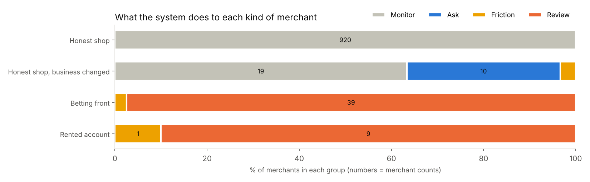

# TrustLoop: does this merchant's money match its business?

A working prototype for the **Merchant Legitimacy Challenge**:

> How might a payment provider identify merchants whose actual activity (e.g. illegal betting)
> differs from their declared business, while protecting legitimate businesses from unnecessary
> scrutiny, disruption or penalties?

**New here? Read [`explained/00_START_HERE.md`](explained/00_START_HERE.md) first.** It explains
everything in plain English. No coding or statistics background needed.

## The idea in one line

Don't ask *"is this behaviour unusual?"* Ask *"does this behaviour match what the merchant declared,
compared with similar shops in the same week?"* Then respond **proportionately**: ask first, add
friction second, and hold money only when there's independent corroboration.

## Headline results (synthetic data, 1,000 merchants, 37 weeks)

| | Typical "own-history" detector | TrustLoop |
|---|---|---|
| Betting fronts & rented accounts caught | **20%** | **100%** |
| Honest shops penalised | 0 of 920 | **0 of 920** |
| Honest shops whose business changed, penalised | 0 of 30 | **1 of 30** (10 more simply asked to explain) |
| Honest sweet/electronics shops with a "sales spike" alert in Diwali week | **62%** | **1%** |
| Bad merchants NOT on the known-bad list that the network still linked to one | | **93%** |

Full results and charts: [`reports/results.md`](reports/results.md).



## Run it

```bash
pip install -r requirements.txt
```

```bash
python run_all.py --small
```

```bash
streamlit run app/dashboard.py
```

Step-by-step instructions for beginners: [`explained/08_how_to_run.md`](explained/08_how_to_run.md).

## What's in the repo

| Path | What it is |
|---|---|
| `explained/` | **Plain-English guide**: the problem, the idea, every signal, scoring, results, pitch guide, glossary |
| `src/generate.py` | Creates a realistic fake world: 1,000 merchants, ~3 million UPI payments, IPL, Diwali |
| `src/features.py` | Turns payments into 10 weekly signals per merchant |
| `src/score.py` | Drift score: each merchant vs its peers, same week |
| `src/network.py` | Finds merchants sharing phones, bank accounts and customers with known betting accounts |
| `src/actions.py` | Proportionate response ladder plus plain-English reasons for every flag |
| `src/evaluate.py` | Measures accuracy against the hidden truth; writes `reports/` |
| `app/dashboard.py` | Streamlit demo: risk queue, drill-down, merchant's view, customer's payment screen |
| `tests/` | Automated checks (`pytest -q`) |
| `data/` | Generated data (the big files are recreated by `run_all.py`) |
