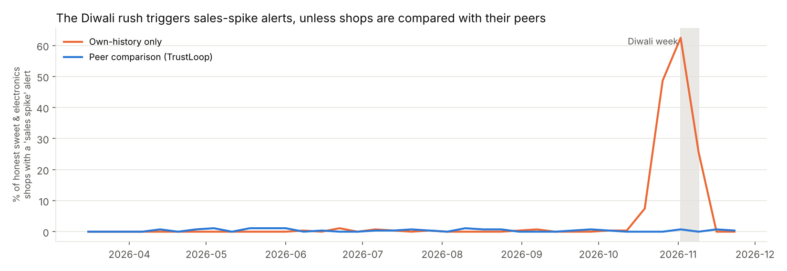
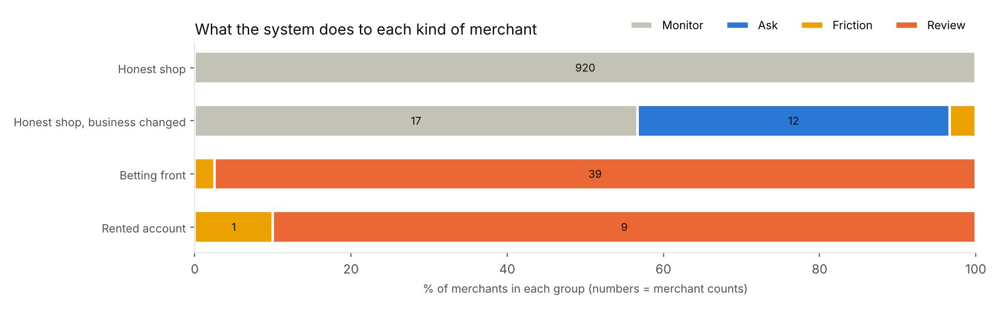
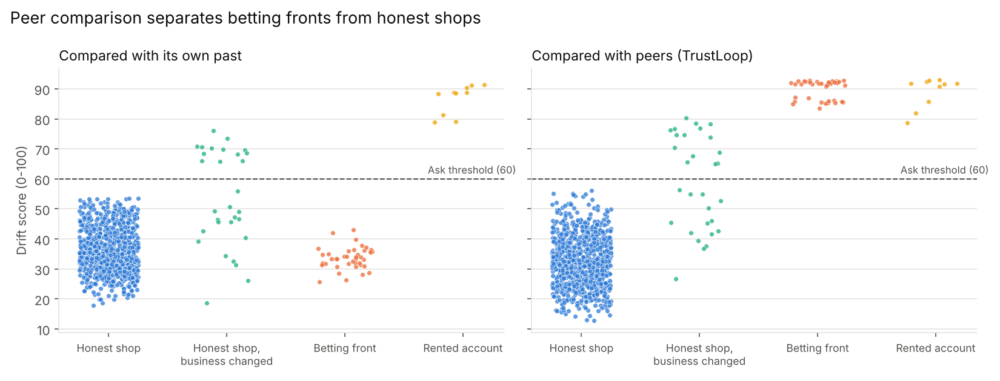
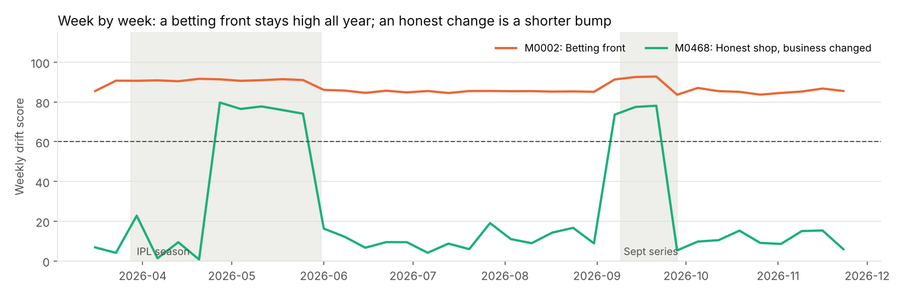
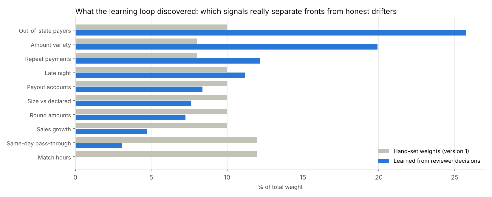
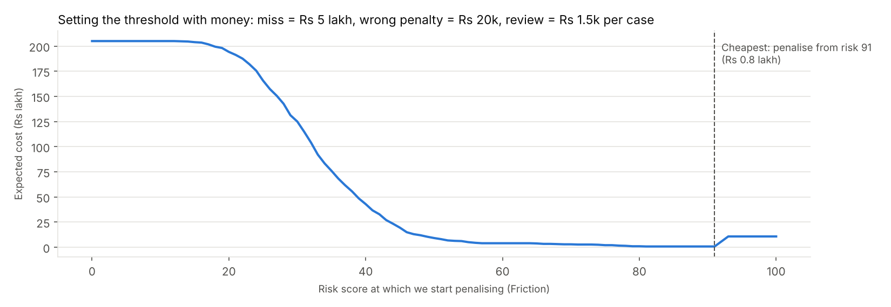
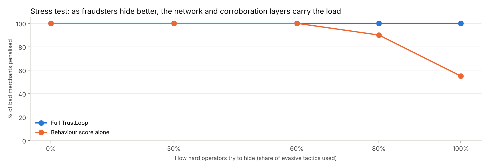

# Results (auto-generated by `python -m src.evaluate`)

Synthetic world: **1,000 merchants**, 37 weeks (2026-03-16 to 2026-11-29), covering IPL, a September cricket series and Diwali.

| Hidden truth | Merchants |
|---|---|
| Honest shop | 920 |
| Honest shop, business changed | 30 |
| Betting front | 40 |
| Rented account | 10 |

## 1. Headline comparison

*Precision* = of the merchants we acted on, the share that were really bad.  
*Recall* = of the really bad merchants, the share we acted on.

| system                                                                      | counts as flagged           | precision   | recall   | honest shops hit   | honest drifters hit   |
|:----------------------------------------------------------------------------|:----------------------------|:------------|:---------|:-------------------|:----------------------|
| A. Own-history only (typical anomaly detector)                              | any action (Ask or above)   | 43%         | 20%      | 0 of 920           | 13 of 30              |
| A. Own-history only (typical anomaly detector)                              | penalty (Friction or above) | 91%         | 20%      | 0 of 920           | 1 of 30               |
| B. Peer drift score only                                                    | any action (Ask or above)   | 77%         | 100%     | 0 of 920           | 15 of 30              |
| B. Peer drift score only                                                    | penalty (Friction or above) | 89%         | 100%     | 0 of 920           | 6 of 30               |
| C. Full TrustLoop (peer + network + change points + learning loop + ladder) | any action (Ask or above)   | 79%         | 100%     | 0 of 920           | 13 of 30              |
| C. Full TrustLoop (peer + network + change points + learning loop + ladder) | penalty (Friction or above) | 98%         | 100%     | 0 of 920           | 1 of 30               |

## 2. Diwali false alarms

A common rule is 'alert when sales jump far more than usual' (growth z-score of 3 or more). Share of **honest** sweet and electronics shops triggering it in the worst week: **62% with own-history comparison** vs **1% with peer comparison**.

## 3. The network layer

Bad merchants **not** on the known-bad list: 30. Linked to a known-bad merchant through the network: **93%**. Ending at Friction or Review: **100%**.

## 4. What happens to each kind of merchant

| Hidden truth                  |   Ask: neutral prompt to explain the change |   Friction: lower limits, T+2 settlement |   Monitor |   Review: 20% rolling reserve + human review |
|:------------------------------|--------------------------------------------:|-----------------------------------------:|----------:|---------------------------------------------:|
| Honest shop                   |                                           0 |                                        0 |       920 |                                            0 |
| Honest shop, business changed |                                          12 |                                        1 |        17 |                                            0 |
| Betting front                 |                                           0 |                                        1 |         0 |                                           39 |
| Rented account                |                                           0 |                                        1 |         0 |                                            9 |

## 5. When did it change? (change-point detection)

For every merchant we find the week its score stepped up. For the 10 rented accounts, the detected week matched the real handover week exactly in **100%** of cases. Merchants whose behaviour shift came within 3 weeks of a phone/bank-account change: Rented account: 10.

## 6. The learning loop

Simulated review history: 82 past cases (50 confirmed, 32 cleared; flagged cases plus a 2% random audit). A logistic regression learned which signals separate confirmed fronts from cleared merchants. It learned that **match hours** matter much less than we assumed (honest restaurants screening matches have them too) and that **out-of-state payers** and **low amount variety** matter more.

## 7. Second opinion: anomaly detector (no labels needed)

Median anomaly percentile (100 = most unusual merchant): Honest shop: 46, Honest shop, business changed: 94, Betting front: 97, Rented account: 99. Honest merchants whose business changed are also unusual, which is why anomaly alone is used only to choose which unflagged merchants to audit, never to penalise.

## 8. Choosing the threshold with money

Assumed costs: missed front Rs 500,000; honest merchant wrongly penalised Rs 20,000; analyst review Rs 1,500 per case. Lowest expected cost at risk score **91** (catches 50, misses 0, wrongly penalises 0).

## 9. Stress test: what if fraudsters hide better?

Five fresh worlds of 400 merchants, each with more evasive operators.

| evasion   |   bad merchants | caught (Friction+)   | caught by behaviour alone (drift 75+)   | caught, NOT on known-bad list   |   honest shops penalised |   honest drifters penalised |   honest merchants asked |
|:----------|----------------:|:---------------------|:----------------------------------------|:--------------------------------|-------------------------:|----------------------------:|-------------------------:|
| 0%        |              20 | 100%                 | 100%                                    | 100%                            |                        0 |                           0 |                        1 |
| 30%       |              20 | 100%                 | 100%                                    | 100%                            |                        0 |                           0 |                        3 |
| 60%       |              20 | 100%                 | 100%                                    | 100%                            |                        0 |                           0 |                        2 |
| 80%       |              20 | 100%                 | 90%                                     | 100%                            |                        0 |                           0 |                        2 |
| 100%      |              20 | 100%                 | 55%                                     | 100%                            |                        0 |                           0 |                        2 |

## 10. Reality check against real NPCI data

Average payment size of honest shops in the simulation vs the real average for the same merchant category from NPCI's July 2025 UPI statistics (`data/real/`).

|             |   real average payment (NPCI, Jul 2025) |   simulated honest shops | simulated / real   |
|:------------|----------------------------------------:|-------------------------:|:-------------------|
| electronics |                                    1093 |                     1096 | 1.00x              |
| kirana      |                                     214 |                      213 | 1.00x              |
| pharmacy    |                                     398 |                      398 | 1.00x              |
| restaurant  |                                     158 |                      158 | 1.00x              |
| sweet_shop  |                                     262 |                      262 | 1.00x              |

## Caveat

These numbers come from *synthetic* data that we designed, so they show the method works as intended, not how it would perform on a real payment provider's data. Real fraudsters adapt; the plan for that is in `explained/10_limitations_and_next_steps.md`.